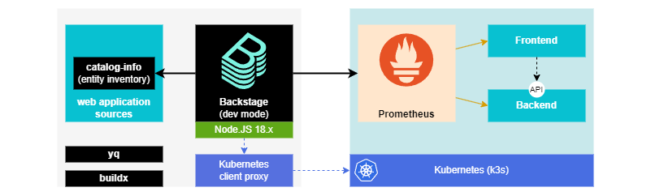

# Environment



Application | URL
--- | ---
Argo CD | [Click here]({{TRAFFIC_HOST1_10080}}) user: **admin**, password: **admin**
Prometheus | [Click here]({{TRAFFIC_HOST1_9090}})
App frontend | [Click here]({{TRAFFIC_HOST1_18080}})
App backend | [Click here]({{TRAFFIC_HOST1_18180}})
Backstage | [Click here]({{TRAFFIC_HOST1_8008}})

Deploy the Backstage prerequisites.

```bash
kubectl apply -f ~/deploy/argocd/backstage-prereq.yaml
```{{exec}}

Deploy the Backstage application using Argo CD.

```bash
argocd app create backstage -f ~/deploy/argocd/backstage.yaml
```{{exec}}

Application | URL
--- | ---
Backstage | [Click here]({{TRAFFIC_HOST1_8008}})


Register the example application using the Backstage UI:

```
https://github.com/testruction/fastapi-sqlalchemy-cockroachdb/blob/prometheus/catalog-info.yaml
```{{copy}}
