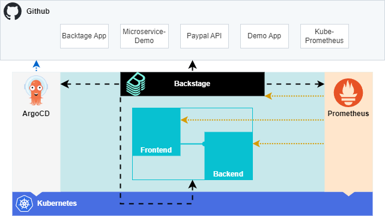

# Environment



Use the following command to generate some load on the Demo App.

```bash
locust --autostart -f ~/tests/locustfile.py --users 5 --spawn-rate 2 -H http://localhost:18180
```{{exec}}

Application | URL
--- | ---
Backstage | [Click here]({{TRAFFIC_HOST1_7007}})
Argo CD | [Click here]({{TRAFFIC_HOST1_10080}}) user: **admin**, password: **admin**
Prometheus | [Click here]({{TRAFFIC_HOST1_9090}})
Demo App frontend | [Click here]({{TRAFFIC_HOST1_18080}})
Demo App backend | [Click here]({{TRAFFIC_HOST1_18180}}/v1/docs)
Demo App load generator | [Click here]({{TRAFFIC_HOST1_8089}})
